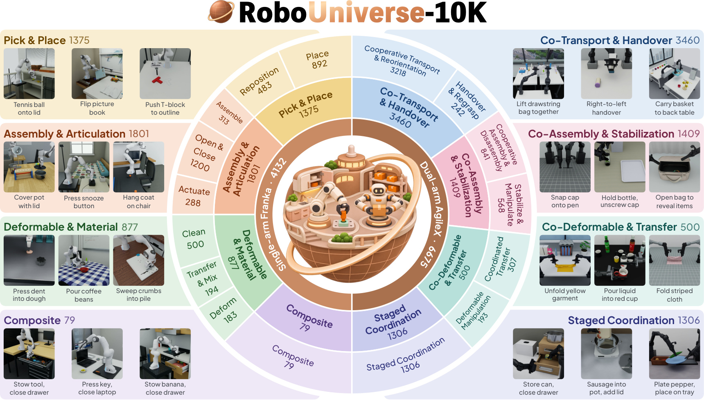
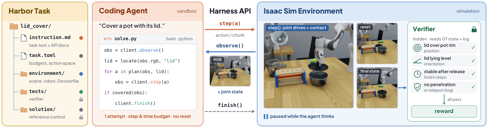

# RoboUniverse-10K evaluation

  
  

*From the paper: task families and example environments across the full RoboUniverse-10K collection.*

Run a coding agent or a reference controller against one physical manipulation environment or the frozen 500-task selection. A Docker Compose simulation service owns the scene and evidence. The agent gets the task instruction and an observation/action client. Harbor runs the verifier separately after collection. A successful verdict earns 1, failure or inconclusive earns 0; an infrastructure exception is not a scored attempt.

*From the paper: a Harbor evaluation episode for the task of covering a pot with its lid.*

Use Linux x86_64, an RTX-capable NVIDIA GPU/driver compatible with Isaac Sim 5.1, NVIDIA Container Toolkit, Docker and Compose v2+, Python 3.12, and disk space for the Isaac installation, task builds and trial logs. Allow outbound HTTPS to Python, Debian, NVIDIA, PyTorch and asset sources during setup. Evaluation requires the Isaac Sim license; review it before running.

From this repository, install the evaluator and Hugging Face CLI:

~~~bash
python3.12 -m venv .venv
. .venv/bin/activate
pip install -r requirements.txt huggingface_hub
~~~

Download one task anonymously from the [RoboUniverse-10K dataset](https://huggingface.co/datasets/Einsia/RoboUniverse-10K). The revision below pins the 10,807 environments and the official Final 500 selection for this release.

~~~bash
export HF_HUB_DISABLE_IMPLICIT_TOKEN=1
unset HF_TOKEN HUGGING_FACE_HUB_TOKEN
export HF_DATASET=Einsia/RoboUniverse-10K
export HF_REVISION=ae170e8093dd6061765c14f2fb6a209432517d85
export DATA=./dataset
CASE=000095_rotate_twist
hf download "$HF_DATASET" catalog.csv splits/heldout500.csv \
  --repo-type dataset --revision "$HF_REVISION" --local-dir "$DATA"
archive=$(awk -F, -v id="$CASE" '$1 == id {print $3; exit}' "$DATA/catalog.csv")
test -n "$archive" && hf download "$HF_DATASET" "$archive" \
  --repo-type dataset --revision "$HF_REVISION" --local-dir "$DATA"
~~~

With the snapshot from the previous step:

~~~bash
python evaluate.py list --data "$DATA" --split heldout500
docker build -t robouniverse-sim:5.1.0-v1 docker/sim-base
docker build -t robouniverse-agent:1 docker/agent-base
python evaluate.py run --data "$DATA" --case "$CASE" --work ./work/oracle --agent oracle --gpu 0 --accept-isaac-eula
~~~

The two RoboUniverse image tags above refer to images built on your machine. The Dockerfiles download pinned public base images, including NVIDIA Isaac Sim from NGC. There is no RoboUniverse registry login or prebuilt RoboUniverse image to pull.

To evaluate the 500-task selection, download its archives from the same commit. Set the provider credentials required by the Harbor adapter when evaluating a model.

~~~bash
python - "$DATA" <<'PY' | xargs -r -n 50 sh -c 'hf download "$HF_DATASET" "$@" --repo-type dataset --revision "$HF_REVISION" --local-dir "$DATA" || exit 255' sh
import csv
import sys
from pathlib import Path

data = Path(sys.argv[1])
with (data / 'catalog.csv').open() as catalog:
    archives = {row['case']: row['archive'] for row in csv.DictReader(catalog)}
with (data / 'splits/heldout500.csv').open() as split:
    for row in csv.DictReader(split):
        print(archives[row['case']])
PY
python evaluate.py run --data "$DATA" --split heldout500 --work ./work/agent-trial --agent "$HARBOR_AGENT" --model "$HARBOR_MODEL" --gpu 0 --accept-isaac-eula
~~~

Each run requires a new work directory. Run one agent per task, sequentially, with no automatic retries. Keep work directories private: they contain ephemeral access tokens, logs and captures. The normal results are under work/agent-trial/jobs/CASE; a verifier result is not inferred from the CLI exit status. Use summarize.py to join trial outcomes to the intended cases and report missing and error counts separately. For storage-constrained runs, download only catalog.csv, the split and selected ZIPs. Avoid preparing the full collection on a small disk.

In the grading revision, the task allows 1,800 seconds for the simulator collection hook, including a 1,770-second HTTP read timeout. Evidence export gets a budget based on completed steps, capped at 1,650 seconds. Keep the runner's collection limit at least 1,800 seconds. These limits apply after the rollout; they do not extend an agent's time or change the success conditions. Plan host RAM using each task's environment.memory_mb (simulator container limit: 18 to 44 GiB). If a live service reports an infrastructure exception, inspect the collected rollout/infra_error.json for the first recorded phase, last confirmed step when known, and exception. A killed container may leave no such file. An absent reward is an unscored trial.

For a dry preparation, use the same command with prepare instead of run. No GPU or Harbor is needed to list or prepare. The generated task directory has standard instruction.md, task.toml, environment/, solution/ and tests/. The simulator builds from the pinned official NVIDIA Isaac Sim 5.1.0 container, and the agent builds from pinned public Python. The simulator download is large. On a proxied network pass Docker's standard build proxy arguments when building the two base images. Upstream robot files are checked by SHA256 and reused from the local asset cache.

~~~bash
python summarize.py --jobs work/agent-trial/jobs --manifest work/agent-trial/selection.csv
python verify_anonymous.py --data "$DATA" --output asset-readback.json
~~~

The first command reports expected, scored, missing and error counts. The second downloads every unique externally resolved asset without a Hub token, browser session or asset cache. Use verify_published.py after upload to check the complete HF dataset separately. Record the dataset revision, evaluation commit, hardware, adapter version and model settings with any reported score.

## Run the released model

[RoboUniverse-35B-A3B](https://huggingface.co/Einsia/RoboUniverse-35B-A3B) is Qwen3.6-35B-A3B fine-tuned on successful agent trajectories from these environments. It works as the model behind Claude Code 2.1.283 with thinking off. `inference.py` applies the settings it needs: it serves the model with SGLang, checks the server, and runs Harbor with the right Claude Code options. Read the [model card](https://huggingface.co/Einsia/RoboUniverse-35B-A3B) for the full list of settings and why each one matters.

The model server needs GPU memory for the 67 GB of bf16 weights plus the KV cache. That means one large GPU (we tested a B300 and a 268 GB L20D), or two 80 GB GPUs with `--tp 2` (untested). It does not need the simulator's RTX features, and it can run on a different machine from the simulator. Install SGLang 0.5.21 in its own environment, because it pins its own PyTorch:

~~~bash
python3.12 -m venv .venv-sglang
.venv-sglang/bin/pip install "sglang==0.5.21"
python inference.py download --dir ./RoboUniverse-35B-A3B
python inference.py serve --python .venv-sglang/bin/python --model ./RoboUniverse-35B-A3B --gpus 0 --port 30000
~~~

`download` fetches the weights anonymously (72 GB). `serve` prints and runs the SGLang command: the bundled chat template (thinking off), no reasoning parser, the `qwen3_coder` tool-call parser, the PIL image processor, Triton MoE, bf16 KV cache and a 262,144-token context. Add `--blackwell` on B200/B300 for the faster attention backend used in our evaluation. Startup takes several minutes, longer on the first launch while kernels compile. SGLang compiles some kernels at startup. On older distributions such as RHEL 8, it may need GCC 11 or newer on `PATH` (for example a gcc-toolset), and a `libstdc++.so.6` that provides `GLIBCXX_3.4.29` (for example the one from conda) on `LD_LIBRARY_PATH`.

From the evaluator environment of the previous sections, check the server, then run one case or the whole split. `--server` must be an address that Docker containers can reach, such as the model server's IP; `localhost` does not work from inside the agent container.

~~~bash
export SERVER=http://<model-server-ip>:30000
python inference.py check --server "$SERVER"
python inference.py run --data "$DATA" --case "$CASE" --work ./work/ru35b-$CASE --server "$SERVER" --gpu 0 --accept-isaac-eula
python inference.py run --data "$DATA" --split heldout500 --work ./work/ru35b-final500 --server "$SERVER" --gpu 0 --accept-isaac-eula
~~~

`check` sends a text request and a tool-call request, and confirms that the server refuses thinking requests. `run` materializes each case like `evaluate.py` and then calls `harbor run -a claude-code -m anthropic/RoboUniverse-35B-A3B --ak version=2.1.283 --ak max_thinking_tokens=0`. It passes the endpoint into the agent container and adds the server to `NO_PROXY`. `--gpu` takes a GPU index or UUID for the simulator. Results use the same layout as `evaluate.py`, and a summary is printed at the end. Without `MAX_THINKING_TOKENS=0`, Claude Code asks for thinking on every request and SGLang rejects it with HTTP 400.

## Citation

If you use RoboUniverse-10K in your research, please cite:

~~~bibtex
@misc{liu2026robouniverse,
  title = {RoboUniverse-10K: Toward the Scaling Era of Agentic Robotics
           via Real-to-Sim Environments},
  author = {Jinkun Liu and Yingze Wang and Situ Wang and Deyao Hong
            and Mingju Gao and Wenyi Li and Yizhe Chi and Youjie Zheng
            and Kaisen Yang and Calvin Xiao and Tiga Altman and Huan-ang Gao},
  year = {2026}
}
~~~
